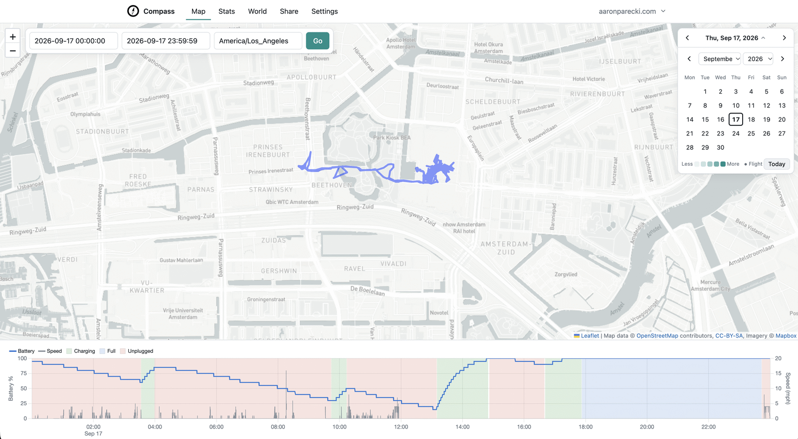
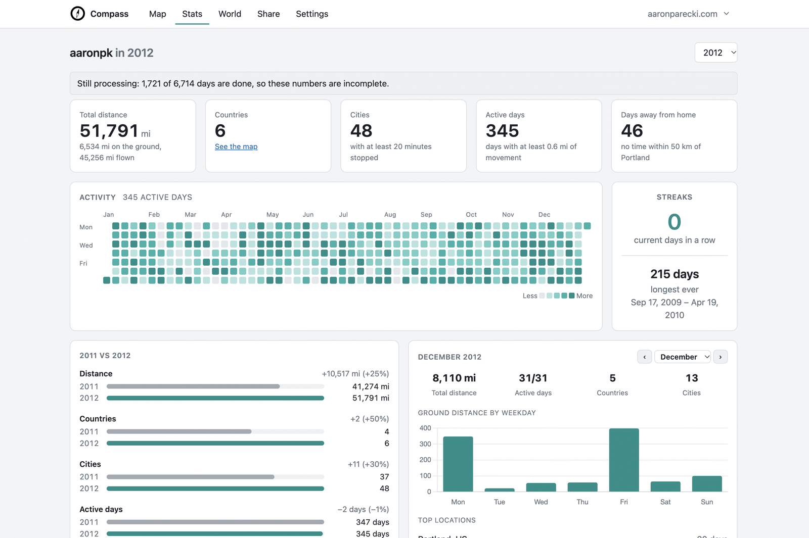
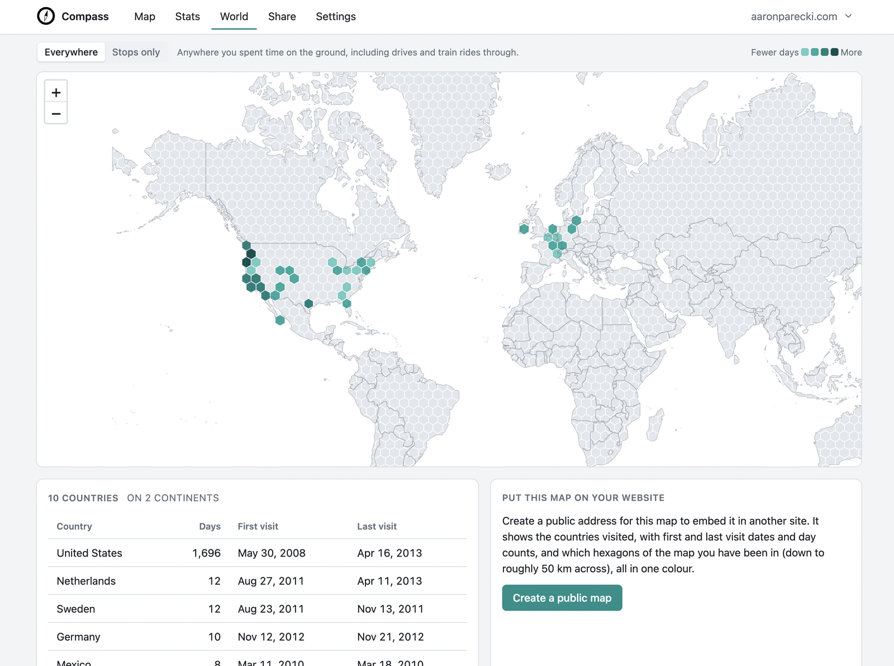

# Compass

Compass is a GPS tracking server that stores data in [flat files](https://github.com/aaronpk/QuartzDB).



What it does:

* **Map** - browse any day or range of time on a map, with a graph of battery level, speed and app events. The calendar shades each day by how far you travelled.
* **Stats** - a yearly page per database: distance, countries and cities, active days and streaks, a monthly digest, distance by mode of travel and first visits.
* **World** - a map of everywhere you have been, as hexagons that get finer as you zoom in. It can be published and embedded in another website.
* **Share** - links that show your current location and recent track to anyone who has them, for a set time or until you stop them.
* **Trips** - trips recorded by a device can be posted to your website with Micropub, and other services can be pinged when a location arrives.
* **API** - for writing and reading locations, used by [Overland](https://github.com/aaronpk/Overland-iOS) and other apps.

The yearly stats page:



The world map:



Upgrading an existing install from the old Lumen version? See [UPGRADING.md](UPGRADING.md).

## Requirements

* PHP 8.4 or above
* MySQL or MariaDB (for user accounts, the list of databases and the stats derived from the location data, not for the location data itself)

### PHP extensions

You'll need to make sure the following PHP extensions are installed. Typically these are installed using the package manager of your operating system.

* curl
* mbstring
* pdo_mysql
* xml
* zip

### Optional

* Redis (for the job queue, which can use MySQL instead, and for filtering out duplicate points)
* A [Mapbox](https://www.mapbox.com/) account, for the map tiles
* nginx with the [nchan](https://nchan.io) module, to push locations to shared maps as they arrive


## Setup

Compass is built using the [Laravel framework](https://laravel.com/). If you have any trouble getting started, you can refer to the [Laravel documentation](https://laravel.com/docs/13.x) for tips that may have been skipped or assumed in these instructions.

In the `compass` directory, copy `.env.example` to `.env` and fill in the details. Install the dependencies with composer, then generate the key that encrypts session cookies.

```
$ composer install
$ php artisan key:generate
```

Once you've created the database and configured the settings in `.env`, run the migrations to set up all the tables.

```
$ php artisan migrate
```

Things to set in `.env`:

* `BASE_URL` - the address Compass is served from, ending with a slash.
* `STORAGE_DIR` - where the location data is written, ending with a slash. The web server (or the PHP process if you're using php-fpm) must be able to write there.
* `MAPBOX_TOKEN` - a public access token from your Mapbox account. Without one the maps draw your tracks on a plain background.
* `ALLOW_NEW_USERS` - whether anyone can create an account by signing in. When it is `false`, add your own website address as a row in the `users` table to be able to sign in the first time.

You sign in with your website address ([IndieAuth](https://indieauth.net/)). Your site needs to advertise an authorization endpoint; there is no fallback.


### Web Server
Point the web root at `compass/public`. Your web server will need to support URL re-routing to the index.php file of compass. This will vary based on your web server.

- If you're using Apache, this will involve URL re-writing likely using .htaccess
- If you're using Nginx, this will involve incorporating the following code into your server block, you should also add any applicable fastcgi settings inside the location block below:

```
try_files $uri /index.php?$args;

  location /index.php {
    fastcgi_param   SCRIPT_FILENAME $document_root$fastcgi_script_name;
  }
```

### Job Queue
For the job queue you will need one of the options Laravel supports. The two most likely options are an SQL database or Redis.
You can find other supported options [here](https://laravel.com/docs/13.x/queues)

If you're using the database queue driver (`QUEUE_CONNECTION=database` defined in `.env`), you'll need to create the migration for that table:

```
$ php artisan queue:table
$ php artisan migrate
```

If you're using Redis, make sure you've installed the Redis server and set `QUEUE_CONNECTION=redis`. (The older names `QUEUE_DRIVER` and `CACHE_DRIVER` still work.)

There are two kinds of work on the queue, each with its own worker:

```
$ php artisan queue:work --queue=compass
$ php artisan queue:work --queue=compass-stats,compass-backfill
```

The first posts trips and sends pings. The second keeps the stats tables up to date. To run them in the background, use the systemd units in `compass/deploy`: `compass-queue@.service` with `compass-queue.target` for the first, and `compass-stats@.service` for the second. Restart them after deploying new code.

### Places data for stats

Compass works out the country, city and timezone of a location from data it ships with, without calling any outside service. The country borders are already in the repository (`compass/resources/geo`). Load the lookup tables once after running the migrations:

```
$ php artisan geo:import
```

This downloads the list of cities with a population over 5,000 from GeoNames (about 6 MB) and fills the `geo_cities` and `geo_countries` tables. Run it again whenever you want newer city data.

Data sources:

* City data from [GeoNames](https://www.geonames.org/), licensed under [CC BY 4.0](https://creativecommons.org/licenses/by/4.0/).
* Country borders made with [Natural Earth](https://www.naturalearthdata.com/), which is in the public domain. Borders follow Natural Earth's de facto boundaries. Territories such as Puerto Rico, Hong Kong and Greenland are listed separately from their sovereign country, and places without an ISO code (Somaliland, Northern Cyprus) are included under Natural Earth's own codes.

### Stats

The stats page, the world map and the stats API read from tables that Compass derives from the location data. After `geo:import` (above), build them once for the data you already have:

```
$ php artisan stats:backfill
```

This queues the work; `php artisan stats:backfill --sync` does it in the foreground with a progress bar instead. A day of data takes around a tenth of a second. From then on, new data is picked up automatically within about five minutes, by a job on the `compass-stats` queue. Run a worker for it with `compass/deploy/compass-stats@.service`.

After an update that changes how the stats are worked out, run `php artisan stats:backfill` again: it reprocesses the days that were done with the older version.

The world map covers the land with hexagons and fills the ones you have been in, either anywhere on the ground or only where you stopped. The hexagons are four degrees of longitude wide when the map is zoomed out and get smaller as you zoom in, down to half a degree. The public, embeddable version of the map (turned on from the World page) shows the list of countries and the hexagons visited in one colour, without the number of days in each; add `?view=stops` to its address to leave out places you only passed through. The hexagons on land come from `public/assets/world-hex.json` and `world-hex-fine.json`, built by `php artisan geo:build-hex-grid`.

Other commands: `stats:status` shows progress, and `stats:explain {database} {date}` shows the stops and moves found for one day. All of the stats tables can be emptied and rebuilt; the location files are never changed.

### Live sharing

A share link (created from the Share page of a database, or by a device through `/api/share`) shows the current location on a map. By default the page asks for the location every few seconds. To have new locations pushed to viewers the moment they arrive, install nginx's [nchan](https://nchan.io) module, follow `compass/deploy/nginx-nchan.conf`, and set `NCHAN_PUBLISH_URL` in `.env`.

A viewer of a share link is sent the position, time, speed and accuracy of each point, and nothing else from the record. The track shown starts when the link was created, or at the start of the trip in progress if there was one.

## API

After you create a tracking database, you can visit the database's settings page to get a read or write token. These tokens are used with the API to update or retrieve data.

### Writing

To write to a database, make a POST request in JSON format with the following keys:

`POST /api/input`

* locations - a list of GeoJSON objects
* token - the write token for the database (as a query string parameter or in the post body)

The GeoJSON objects must have at least one property, "timestamp", which is can be any value that can be interpreted as a date. The object can have any additional properties you wish.

The open source iOS [Overland](https://github.com/aaronpk/Overland-iOS) will send data in this format by default.

```
POST /api/input?token=XXXXXXX HTTP/1.1
Content-type: application/json

{
  "locations": [
    {
      "type": "Feature",
      "geometry": {
        "type": "Point",
        "coordinates": [-122.621, 45.535]
      },
      "properties": {
        "timestamp": "2017-01-01T10:00:00-0700",
        "horizontal_accuracy": 65
      }
    }
  ]
}
```


### Reading

To read a database, make a GET request as follows:

#### Get all data for a calendar day

`GET /api/query`

* token - (required) the read token for the database
* tz - (optional, default UTC) timezone string (e.g. America/Los_Angeles) which will be used to determine the absolute start/end times for the day
* format - (optional, default "full") either "full" or "linestring"
 * full - return one JSON record for each result in the database
 * linestring - combine all the returned results into a GeoJSON linestring
* date - specify a date to return all data on that day (YYYY-mm-dd format)
* start, end - in place of date, two timestamps (`YYYY-mm-dd HH:MM:SS`, read in the timezone given by tz) to return everything between them

#### Get the last location before a given timestamp

`GET /api/last`

* token - (required) the read token for the database
* tz - (optional, default UTC) timezone string (e.g. America/Los_Angeles) which will be used to determine the absolute start/end times for the day
* before - (optional, default to now) specify a full timestamp to return a single record before this date (the point returned will be no more than 24 hours before the given date)
* geocode - (optional) if "true", then the location found will be reverse geocoded using [Atlas](https://atlas.p3k.io) to find the city and timezone at the location

#### Find the last location matching a clock time

`GET /api/find-from-localtime`

This API method can help you answer the question "Where was I when my watch read 9:30am on July 15th?".

Timestamps in Exif data do not include the timezone offset, and there is no standard mechanism for including the timezone offset in Exif. Some Canon cameras put the offset in a field, but not all of them do. You can use this method to find your location given an Exif date.

* token - (required) the read token for the database
* input - specify a clock time in the format `YYYY-mm-dd HH:MM:SS`

This will query the database and find the closest matching location for when your clock read that time.

#### Get the trip in progress

`GET /api/trip`

* token - (required) the read token for the database

Returns the trip a device has started and not yet finished, or `null`.

### Sharing

`POST /api/share`

* token - (required) the write token for the database
* duration - (optional, default 3600) how long the link works, in seconds. `0` makes a link that works until it is stopped from the Share page
* label - (optional) a name for the link, shown on the Share page

Returns the address of a new share link as `{"url": "..."}`.

### Stats

These read the tables described under [Stats](#stats) above, and take the read token.

#### A year of stats

`GET /api/stats`

* token - (required) the read token for the database
* year - (optional, default the newest year with data)

Returns everything the stats page shows: totals, each day's distance, streaks, months, modes of travel, countries, top cities and first visits. Distances are in metres and durations in seconds.

#### Distance per day

`GET /api/days`

* token - (required) the read token for the database
* year - (optional, default the current year)

Returns `{"days": {"2026-01-15": [ground metres, flight metres], ...}}`, with one entry per day that has data. Days are local dates where you were.

#### Countries and places visited

`GET /api/countries`

* token - (required) the read token for the database
* year - (optional, default all time)

Returns the countries with the number of days in each and the first and last visit, and `hexes`: the hexagons of the world map with time on the ground, as `[column, row, days there, days stopped there]`, for each of the map's four grids.


## Credits

Compass icon by Ryan Spiering from the Noun Project.

## License

Copyright 2015 by Aaron Parecki

Compass is licensed under the [Apache 2.0 license](http://opensource.org/licenses/Apache-2.0)

Compass is built using the Laravel framework, which is licensed under the [MIT license](http://opensource.org/licenses/MIT)
